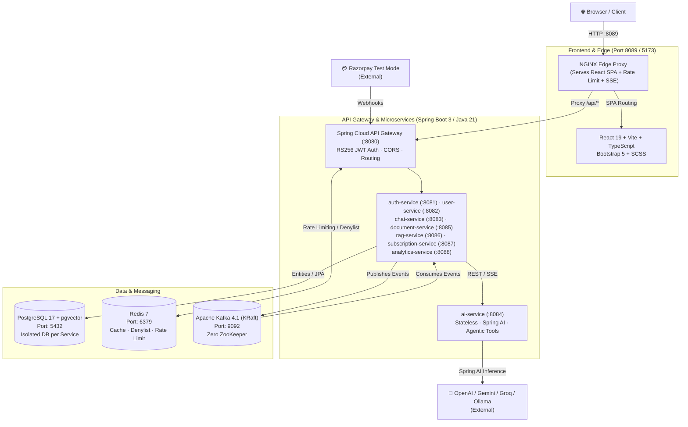

<div align="center">

# NexaAI

**Enterprise Multi-Model AI Chat, RAG & Agentic Workflow SaaS Platform**

Built with a decoupled **Java 21 + Spring Boot 3** microservices architecture, **Spring AI**, **Apache Kafka (KRaft)**, **PostgreSQL + pgvector**, and **React + TypeScript + Bootstrap 5**.

<p>
  
  
  
  
  
  
  
  
  
  
  
  
  
  
  
</p>

</div>

---

## Key Features

- **Multi-Model AI Chat & Streaming**: Real-time SSE token streaming across **OpenAI**, **Google Gemini**, **Groq**, and **Ollama** with automatic provider fallback.
- **Document RAG with Citations**: Upload PDF/TXT/DOCX files; asynchronous Kafka chunking, vector embeddings, and cosine similarity search via **PostgreSQL `pgvector`** with exact page citations.
- **Agentic AI & Visual Workflow Builder**: Drag-and-drop DAG workflow builder (`Trigger → Action → Result`) with Spring AI tool calling (Calculator, Document Search, Controlled DB Lookup, Weather, File Analyzer) and human-in-the-loop approvals.
- **Enterprise Auth & RBAC**: RS256 asymmetric JWT authentication, Google OAuth2 login, email verification, OTP password reset, Redis token revocation, and strict `USER` / `ADMIN` role isolation.
- **Subscriptions & Billing**: Tiered SaaS plans (`Free`, `Pro`, `Enterprise`) powered by **Razorpay (Test Mode)** with HMAC-SHA256 webhook verification and idempotency keys.
- **Admin & Usage Analytics**: Real-time token telemetry, quota enforcement, rate limiting (NGINX + Redis), and system health dashboards.

---

## System Architecture

NexaAI follows a strict **Database-per-Service** microservices pattern with **no shared databases**, **no aggregator POM**, and **Kafka KRaft (zero ZooKeeper)**.



### Microservices Overview

| Service | Port | Database | Core Responsibility |
|---|:---:|---|---|
| **edge (NGINX)** | `8089` | — | Reverse proxy, static SPA host, IP rate limiting, unbuffered SSE |
| **api-gateway** | `8080` | — | Central routing, RS256 JWT validation, CORS, correlation IDs |
| **auth-service** | `8081` | `nexa_auth` | Registration, login, Google OAuth2, OTP reset, RS256 JWT issuance |
| **user-service** | `8082` | `nexa_user` | User profiles, settings, admin user management |
| **chat-service** | `8083` | `nexa_chat` | Conversations, sliding-window memory, DAG workflow execution |
| **ai-service** | `8084` | *Stateless* | Spring AI multi-model routing, fallback, agentic tool calling |
| **document-service** | `8085` | `nexa_document` | File upload (≤25 MB), Apache Tika extraction, Kafka events |
| **rag-service** | `8086` | `nexa_rag` | Chunking, embeddings, `pgvector` HNSW cosine similarity retrieval |
| **subscription-service** | `8087` | `nexa_subscription` | Plans, Razorpay Test Mode checkout, idempotent webhooks |
| **analytics-service** | `8088` | `nexa_analytics` | Kafka usage consumer, token metrics, admin overview |
| **nexa-ai-web** | `5173` | — | React 19 + TypeScript + Bootstrap 5 + SCSS (Light/Dark/System) |

---

## Project Structure

```text
NexaAI/
├── backend/
│   ├── api-gateway/            # Spring Cloud Gateway (JWT filter, routing)
│   ├── auth-service/           # Authentication, JWT, OAuth2, OTP
│   ├── user-service/           # Profiles & admin user controls
│   ├── chat-service/           # Chat, memory & workflow builder engine
│   ├── ai-service/             # Spring AI LLM router & agentic tools
│   ├── document-service/       # File upload & text extraction
│   ├── rag-service/            # Chunking, embeddings & pgvector search
│   ├── subscription-service/   # Plans & Razorpay Test Mode billing
│   └── analytics-service/      # Usage telemetry & admin metrics
├── frontend/
│   └── nexa-ai-web/            # React 19 + TypeScript + Bootstrap 5 + SCSS
├── infrastructure/
│   ├── docker-compose.yml      # Full stack (Postgres, Redis, Kafka KRaft, NGINX, Apps)
│   └── docker/                 # Init SQL scripts, NGINX & Redis configs
└── .github/workflows/          # CI/CD (Backend matrix, Frontend build, Rule checks)
```

---

## Quick Start

### 1. Run Entire Stack with Docker Compose
```bash
docker compose -f infrastructure/docker-compose.yml up -d
```
- **Web App (NGINX Edge)**: `http://localhost:8089`
- **API Gateway**: `http://localhost:8080`
- **Swagger UI (per service)**: `http://localhost:<PORT>/swagger-ui.html`

### 2. Run Locally (Development)
Start infrastructure only (PostgreSQL + pgvector, Redis, Kafka KRaft):
```bash
docker compose -f infrastructure/docker-compose.yml --profile infra up -d
```
Run any backend service independently:
```bash
cd backend/auth-service && mvn spring-boot:run
```
Run the frontend:
```bash
cd frontend/nexa-ai-web && npm install && npm run dev
```

---

## Testing & CI/CD

```bash
# Test any backend microservice independently
mvn -f backend/auth-service/pom.xml test

# Lint, type-check, and build frontend
cd frontend/nexa-ai-web && npm run lint && npm run build
```

- **Backend CI (`.github/workflows/backend.yml`)**: Matrix build and test across all 9 independent services.
- **Frontend CI (`.github/workflows/frontend.yml`)**: TypeScript check, ESLint, SCSS theme verification, bundle secret scan.
- **Architecture Guardrails (`.github/workflows/rules.yml`)**: Enforces zero ZooKeeper, zero Tailwind, database isolation, RBAC (`USER`/`ADMIN`), and Razorpay Test Mode only.
